

  

    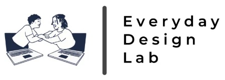
    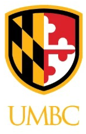
    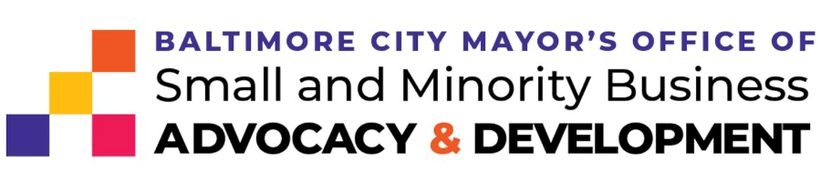
    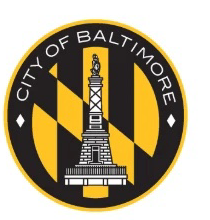
  

  <section class="ahd-hero">
    

      <h1>AI Help Desk</h1>
      
Free, one-on-one AI and tech help for Baltimore's small business owners.

      
Sit down with a member of our team and work through your AI or tech questions together, on your own laptop and your own business tasks. Want to try AI for marketing, set up a new tool, or just get your files and passwords under control? We'll do it side by side, so you leave with the work done <em>and</em> the know-how to do it again.

      
<strong>No AI experience needed.</strong> Start where you are.

      <ul class="ahd-facts">
        <li><i class="fas fa-calendar-alt" aria-hidden="true"></i>Mondays, 1:00–4:00 p.m.</li>
        <li><i class="fas fa-map-marker-alt" aria-hidden="true"></i>3000 Druid Park Dr, Baltimore</li>
        <li><i class="fas fa-hand-holding-heart" aria-hidden="true"></i>Free · drop in or book ahead</li>
      </ul>
      <a class="ahd-btn" href="https://bit.ly/ai-help-desk" target="_blank" rel="noopener noreferrer">Book a time slot</a>
    

    <figure class="ahd-hero-photo">
      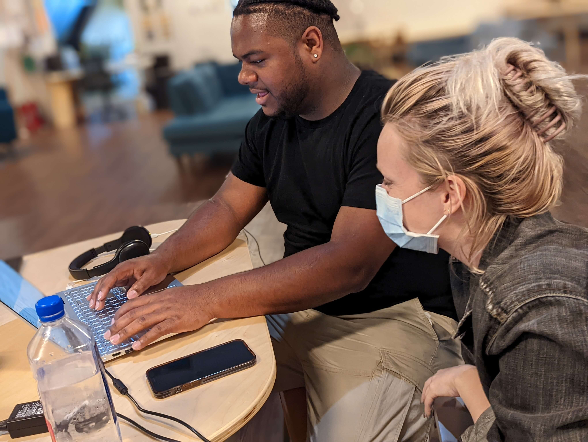    </figure>
  </section>

  
AI Help Desk is a partnership between the <a href="/lab/">Everyday Design Lab</a> at UMBC and the Baltimore City Mayor's Office of Small and Minority Business Advocacy &amp; Development (SMBA&amp;D).

  <section class="ahd-section">
    <h2>Meet the AI Help Desk leads</h2>
    

      <a class="ahd-lead" href="https://qizhao-umbc.github.io/" target="_blank" rel="noopener noreferrer">
        
        

          <h3>Qi Zhao</h3>
          
Lead Tech Provider

          
PhD student, Human-Centered Computing, UMBC · qiz1@umbc.edu

        

      </a>
      <a class="ahd-lead" href="https://marjory-pineda.github.io/" target="_blank" rel="noopener noreferrer">
        
        

          <h3>Marjory Pineda</h3>
          
Tech Provider

          
PhD student, Human-Centered Computing, UMBC · GEM Fellow

        

      </a>
    

    

      <a class="ahd-lead" href="/">
        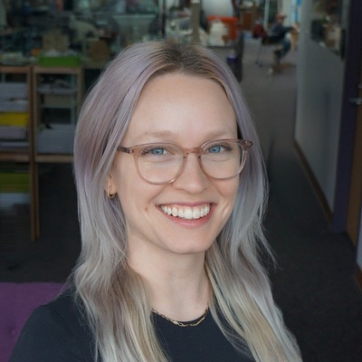
        

          <h3>Dr. Yasmine Kotturi</h3>
          
Faculty Advisor

          
Assistant Professor of Human-Centered Computing, UMBC · Director, Everyday Design Lab

        

      </a>
    

  </section>

  <section class="ahd-section">
    <h2>Why an AI Help Desk?</h2>
    
Small business owners in every industry rely on digital tools, and more and more on AI, to run and grow their businesses. But most AI help comes as workshops and webinars that stay at a high level. They introduce tools without showing how to put them to work in <em>your</em> business. Because AI changes so quickly, keeping up alone is hard.

    
AI Help Desk gives entrepreneurs practical, one-on-one support. We meet you where you are, at the SMBA&amp;D office and at business events around Baltimore. You learn by doing on real business tasks, so you leave with the skills and strategies to solve the next problem on your own.

  </section>

  <section class="ahd-section">
    <h2>Support offered</h2>
    

      

        <h3>1Learn skills to use AI effectively</h3>
        <ul>
          <li>Learn about AI, including how it fits in your business, and get actionable next steps</li>
          <li>Learn to question AI results, recognize its limits, and decide when to use or skip a tool</li>
          <li>Explore how to make AI-generated content reflect your voice and business</li>
        </ul>
      

      

        <h3>2Everyday practical tech help</h3>
        <ul>
          <li>Get one-on-one support on your everyday tech tasks</li>
          <li>Bring any tech question: keyboard shortcuts, organizing files, managing passwords, freeing up storage, setting up printers, and more</li>
          <li>Build tech skills through hands-on learning</li>
        </ul>
      

      

        <h3>3Build networks while learning AI</h3>
        <ul>
          <li>Ease the stress of learning AI by working side-by-side with our team</li>
          <li>Exchange knowledge with other business owners and pass on what you learn</li>
          <li>Build your network and form lasting connections</li>
        </ul>
      

    

  </section>

  <section class="ahd-section">
    <h2>How a session works</h2>
    

      

    <ol class="ahd-steps">
      <li><strong>Bring a question or a task.</strong> Big or small, AI or not. Bring your laptop, or borrow one of ours during the session.</li>
      <li><strong>Work on it together.</strong> You stay in the driver's seat while a team member works beside you, much like pair programming, where two people solve one problem together on one computer.</li>
      <li><strong>Leave with next steps.</strong> You go home with something done and a plan for what's next. If your question needs a specialist (legal, procurement, and more), we connect you with experts at SMBA&amp;D.</li>
    </ol>
    
You can also find us at SMBA&amp;D business events running <em>"Ask me anything about AI"</em> tables.

      

      <figure class="ahd-reel">
        <video controls playsinline preload="metadata" poster="/images/ahd-testimonial-poster.jpg" aria-label="AI Help Desk testimonial video">
          <source src="/files/ahd-testimonial.mp4" type="video/mp4">
          <source src="/files/ahd-testimonial.webm" type="video/webm">
          <a href="https://www.instagram.com/reel/DgN4M7qS2FG/">Watch the AI Help Desk video on Instagram</a>
        </video>
        <figcaption>AI Help Desk testimonial by <a href="https://www.instagram.com/shamirevalintina/" target="_blank" rel="noopener">@shamirevalintina</a></figcaption>
      </figure>
    

  </section>

  <section class="ahd-section">
    <h2>Recent updates</h2>
    
Our <em>"Ask me anything about AI"</em> table at SMBA&amp;D's entrepreneurial outreach event on November 5, 2026.

    

      

        <figure class="ahd-slide">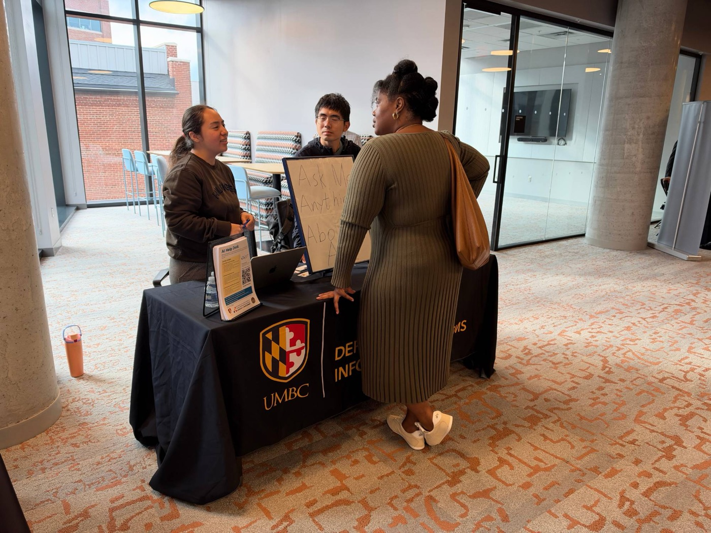</figure>
        <figure class="ahd-slide">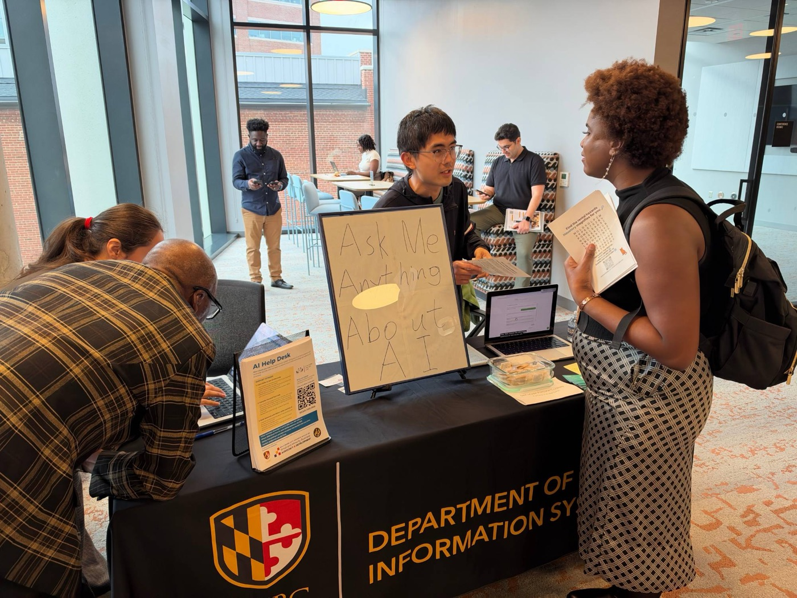</figure>
        <figure class="ahd-slide">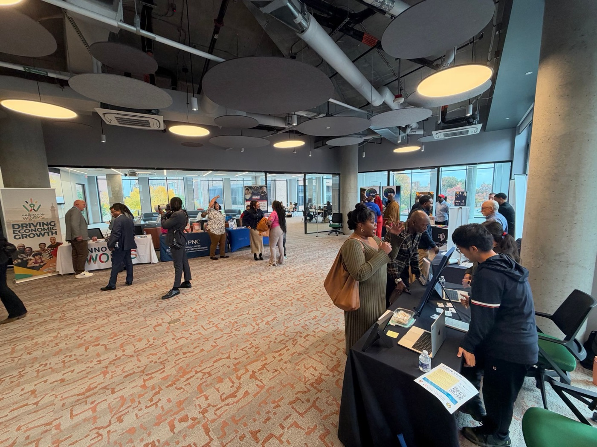</figure>
      

      <button class="ahd-nav ahd-prev" type="button" aria-label="Previous photo">&#8249;</button>
      <button class="ahd-nav ahd-next" type="button" aria-label="Next photo">&#8250;</button>
      

    

  </section>

  

  <section class="ahd-section ahd-when">
    <h2>When &amp; where</h2>
    

      
When

      
Mondays, 1:00–4:00 p.m. November 9, 16, and 30, 2026, then every Monday (except holidays) starting January 25, 2027

    

    

      
Where

      
3000 Druid Park Dr, Suite 3000B, Baltimore, MD 21215 (<a href="https://maps.google.com/?q=3000+Druid+Park+Dr+Suite+3000B+Baltimore+MD+21215" target="_blank" rel="noopener noreferrer">map</a>)

    

    

      
Getting in

      
Free parking is provided. Please ring the doorbell when you arrive.

    

    

      
Cost

      
Free

    

    

      
Sign up

      
Drop in, or book a time slot at <a href="https://bit.ly/ai-help-desk" target="_blank" rel="noopener noreferrer">bit.ly/ai-help-desk</a>

    

    

      
Contact

      
Qi Zhao, <a href="mailto:qiz1@umbc.edu">qiz1@umbc.edu</a>

    

  </section>

  <section class="ahd-section ahd-research">
    

      <h2>Built on research</h2>
      
AI Help Desk builds on <em>Tech Help Desk</em>, a free tech support service for local entrepreneurs that Dr. Kotturi co-designed with an entrepreneurial co-working space in Pittsburgh and that ran for more than four years. That work, published at <a href="https://dl.acm.org/doi/abs/10.1145/3491102.3517708" target="_blank" rel="noopener noreferrer">CHI 2022</a>, showed that entrepreneurs need support that adapts to their changing priorities and covers the "long tail" of everyday computing challenges, not just one tool. Moreover, a follow-up paper published at <a href="https://dl.acm.org/doi/10.1145/3613904.3642191" target="_blank" rel="noopener noreferrer">CHI 2024</a> showed the importance of "deconstructing the veneer of simplicity" around AI tools, helping entrepreneurs understand how to actually put this technology to work for their bottom line.
    

    <figure>
      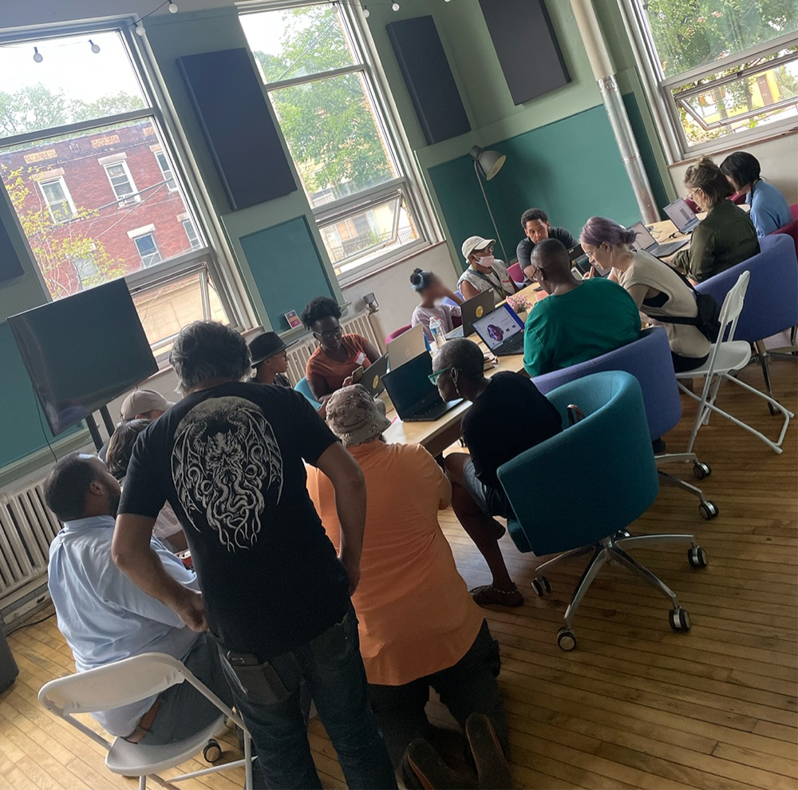
      <figcaption>Learning together at a community tech help session.</figcaption>
    </figure>
  </section>

  <section class="ahd-section ahd-flyer">
    <h2>Share the flyer</h2>
    
Know a business owner who could use a hand? Pass this along.

    <a href="/images/ai-help-desk-flyer.jpg" target="_blank" rel="noopener noreferrer">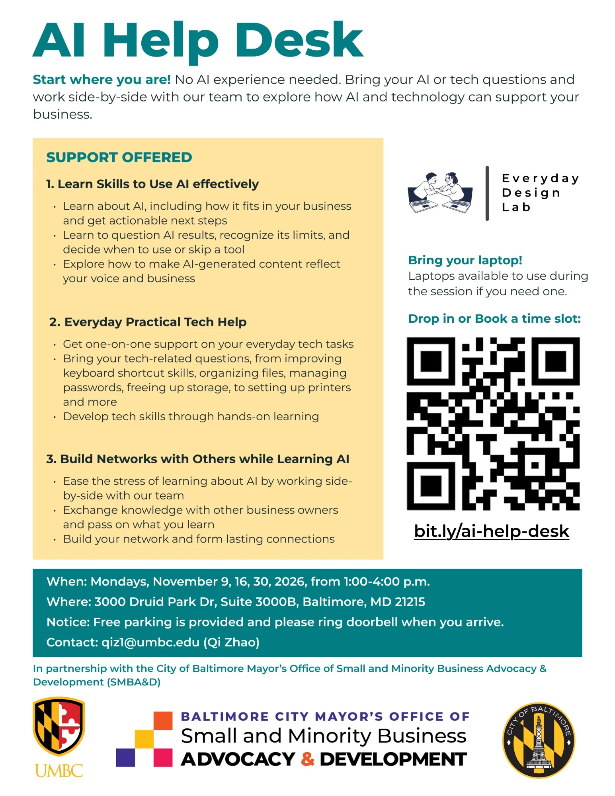</a>
    
<a class="ahd-btn ahd-btn-outline" href="/images/ai-help-desk-flyer.jpg" download>Download flyer</a>

  </section>

